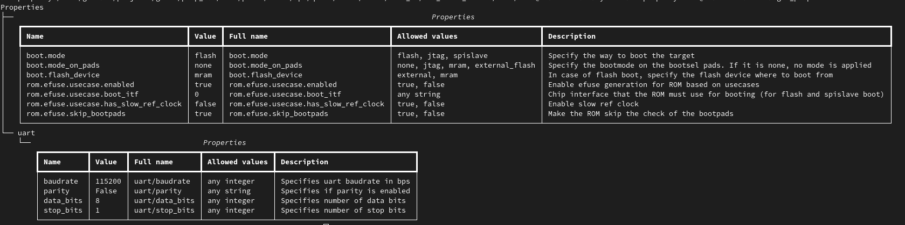

Customization
-------------

The system to be simulated is fully described by the target. This target corresponds to a Python
generator, which is responsible for instantiating, connecting, and configuring the entire set of
components needed to simulate the system.

The system can be customized using attributes, which specify high-level properties such as memory sizes.

The full tree of attributes and parameters can be obtained using the *tree* command: ::

  gvrun --target gap.gap9.evk tree --tree-format=all

This command will produce tables similar to the following:

Since models can declare attributes, they are hierarchical and are displayed as a tree,
with one table per model declaring at least one attribute.

Attributes have default values shown in the tables, which can be overridden in the target name
with the ``attr.<path>=<value>`` qualifier. The path must be the hierarchical name of the
attribute in the entire system.

The effect of this qualifier can be seen in the tables. Changing an attribute value can impact
the architecture of the system, which can change the list of available attributes.

For example, you can change the baud rate of the UART using the following command: ::

  gvrun --target "gap.gap9.evk:attr.uart/baudrate=9600" tree --tree-format=all

Since the platform is compiled for the target name, a target name with qualifiers is a target
of its own, which must be built (``make build TARGETS="gap.gap9.evk:attr.uart/baudrate=9600"``).

Parameters, which configure the execution (the binary, files given to models, ...), are given
with ``--parameter <path>=<value>``. They only apply to the run and do not change the
platform. Config fields declared
for run time (``Annotated[T, Runtime]``) can also be set with ``--parameter``, using their
component path: ::

  gvrun --target event_camera --parameter soc/sensor/nb_events=500 run

